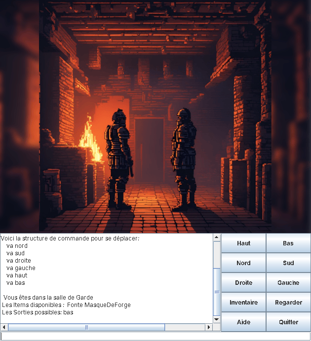
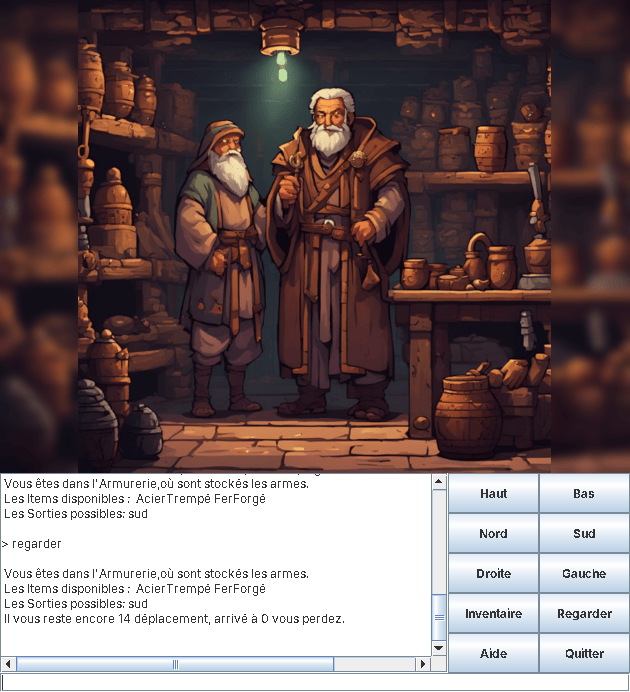
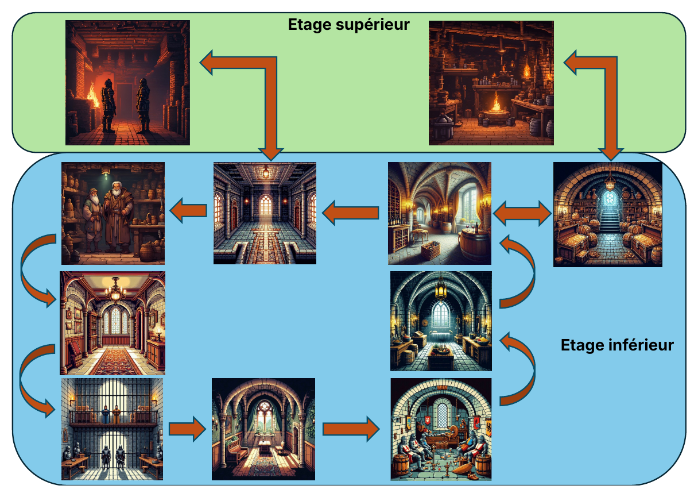
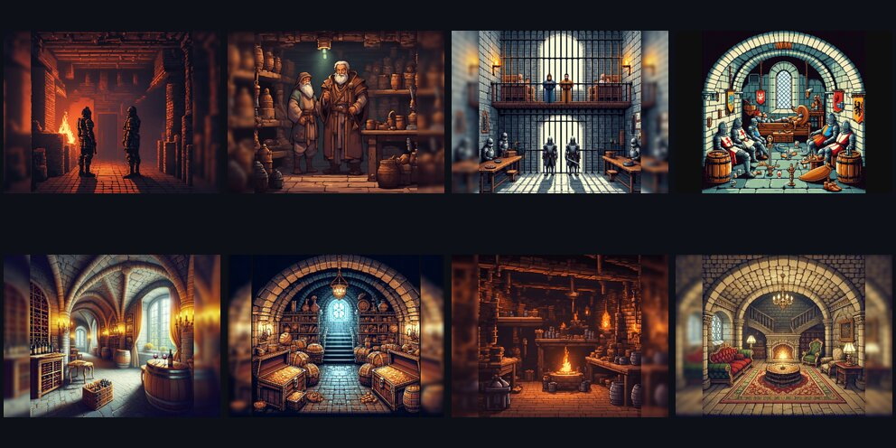

<div align="center">

# ⚒️ Le Monde du Forgeron

**A graphical text-adventure game written in Java / Swing**


&nbsp;&nbsp;

</div>

> [!NOTE]
> 🇫🇷 **This project was developed entirely in French.** The game (story, dialogues, commands), the source code comments, the Javadoc and the project report are all in French. This README is in English so the project can be read by a wider audience.

---

## 📖 About

*Le Monde du Forgeron* ("The Blacksmith's World") is an exploration and puzzle game set in the basement of a medieval castle. You play a blacksmith who must find the rare materials hidden across the dungeon, solve the riddles of the people living there, and reach the **Forge Workshop** to escape before running out of moves.

It was built individually as the semester project of the **Object-Oriented Programming in Java** course (academic project, semester 1, 2024–2025), starting from the classic *World of Zuul* skeleton (Barnes & Kölling) and extended step by step.

## ✨ Features

- 🗺️ **14 rooms over 3 levels**: ground floor, lower floor and a hidden second basement, each with its own illustration
- 🧩 **Riddles and questions**: guards, a merchant and prisoners only hand over their materials if you answer correctly
- 🎒 **Weight-limited inventory**: pick up and drop items; eating meat increases your carrying capacity
- ⏳ **Move limit**: 16 moves to win, or you lose
- 🚪 **Trap doors**: some passages are one-way and wipe your path history
- ↩️ **`retour` command**: walk back through the rooms you came from (history kept in a stack)
- 🌀 **Teleporter (Beamer)**: charge it in a room and teleport back there later
- 🧪 **Test scripts**: replay a sequence of commands from a text file (`teste ideal`)
- 🖱️ **Swing GUI**: room image, game log, text input and direction buttons

## 🗺️ Map

<div align="center">

</div>

The ground floor holds the **Guard Room** (start) and the **Forge Workshop** (exit). The lower floor contains the Armory, the Dungeon, the Rest Area, the Wine Cellar, the Treasure Room and four passage rooms. A hidden second basement, reached through a trap door, holds three haunted rooms and the teleporter.

<div align="center">

</div>

## 🎮 How to play

### Option 1: download and play
1. Make sure **Java 11 or newer** is installed (`java -version`).
2. Download `le-monde-du-forgeron.jar` from the [**Releases**](../../releases/latest) page.
3. Double-click it, or run:
   ```bash
   java -jar le-monde-du-forgeron.jar
   ```

### Option 2: build from source
Requires a **JDK 11+**.

```bash
git clone <this-repository-url>
cd le-monde-du-forgeron
./run.sh        # Linux / macOS
run.bat         # Windows
```

You can also open the `src/` folder directly in **BlueJ** (`package.bluej`) and create a `Game` object.

### Commands (in French)

| Command | Meaning | Example |
|---|---|---|
| `va <direction>` | move (`nord`, `sud`, `droite`, `gauche`, `haut`, `bas`) | `va bas` |
| `regarder` | describe the current room and remaining moves | `regarder` |
| `prendre <item>` | pick up an item (may require answering a question) | `prendre Fonte` |
| `laisser <item>` | drop an item | `laisser Fonte` |
| `inventaire` | show your inventory | `inventaire` |
| `manger <item>` | eat food (+2 inventory capacity) | `manger Viande` |
| `retour` | go back to the previous room | `retour` |
| `charger <item>` | charge the teleporter in the current room | `charger teleporteur` |
| `teleporte <item>` | teleport to the room where it was charged | `teleporte teleporteur` |
| `teste <file>` | run a command script (`ideal`, `court`, `exploration`) | `teste ideal` |
| `aide` | show help | `aide` |
| `quitter` | quit the game | `quitter` |

> [!TIP]
> Picking up an item opens a pop-up question; answers must be typed in lowercase (for simple pick-ups, just answer `oui`). Stuck? `teste ideal` replays the walkthrough moves, and you only have to answer the questions.

## 🏗️ Architecture

```
src/
├── Game.java           # Entry point: creates the engine and the GUI
├── GameEngine.java     # Game logic: world creation, command interpretation, win/lose rules
├── UserInterface.java  # Swing GUI: image, log, input field, buttons
├── Parser.java         # Reads and splits user input
├── Command.java        # A command word plus an optional second word
├── CommandWords.java   # List of valid commands
├── Room.java           # A room: description, image, exits, trap doors, items
├── Item.java           # An item: name, description, weight, question/answer
├── ItemList.java       # A collection of items (rooms and inventory)
├── Beamer.java         # Teleporter, a subclass of Item
├── Player.java         # Location, inventory, carrying capacity, room history (Stack)
├── Images/             # Room illustrations
└── *.txt               # Test scripts for the "teste" command
```

**Concepts used:** encapsulation, inheritance (`Beamer extends Item`), collections (`HashMap`, `Stack`), file reading (`Scanner`), exception handling, event-driven GUI (`ActionListener`) and Javadoc documentation.

## 🙏 Credits & references

- **Inspiration:** the anime series *Tensei Shitara Slime Datta Ken* and *Tensei Shitara Dai Nana Ōji Datta node, Kimama ni Majutsu o Kiwamemasu*
- **Riddles:** adapted from [AideDD – Énigmes](https://www.aidedd.org/adj/enigmes/)
- **Room illustrations:** generated with Microsoft Bing Image Creator
- **Map design:** made with Canva
- **Code base:** the *zuul-bad* lab exercise from the course, with the [zuul-bad guide](https://calbatorix.github.io/zuul-bad/) as a reference
- **Learning resources:** Developpez.net and [Zeste de Savoir](https://zestedesavoir.com/tutoriels/646/apprenez-a-programmer-en-java/) for Swing buttons and layouts, CodeGym for `java.util.Stack`, and the [Oracle Swing tutorial](https://docs.oracle.com/javase/tutorial/uiswing/)

## 👤 Author

**Sivaharan Kumara Segaram**, embedded systems engineering student

---

<sub>Built on the *World of Zuul* educational framework by Michael Kölling and David J. Barnes, as adapted for the course.</sub>
